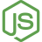

### 강정묵 · Backend Developer

기능을 만드는 것에서 끝내지 않고, 현장에서 돌아가는 것까지 책임지는 백엔드 개발자입니다.

Java · Spring Boot · MyBatis · Oracle을 주력으로 백엔드 개발을 합니다. 안정적인 API 설계와 데이터 처리를 중심에 두고, 배포와 운영까지 이어서 책임지는 방식으로 일합니다. 2024년부터 대입 입시 솔루션 회사에서 근무하고 있습니다.

 

#### 주력 기술

<table>
  <tr>
    <td align="center" width="150">
       
      <b>Java</b>
    </td>
    <td align="center" width="150">
       
      <b>Spring Boot</b>
    </td>
    <td align="center" width="150">
       
      <b>MyBatis</b>
    </td>
    <td align="center" width="150">
       
      <b>Oracle</b>
    </td>
  </tr>
</table>

#### Skills

<table>
  <tr>
    <td><b>Backend</b></td>
    <td>&nbsp;Java &nbsp;&nbsp;&nbsp; &nbsp;Spring Boot &nbsp;&nbsp;&nbsp; &nbsp;MyBatis &nbsp;&nbsp;&nbsp; &nbsp;Node.js</td>
  </tr>
  <tr>
    <td><b>Frontend</b></td>
    <td>&nbsp;React &nbsp;&nbsp;&nbsp; &nbsp;Vue 3 (Pinia) &nbsp;&nbsp;&nbsp; &nbsp;React Native (Expo) &nbsp;&nbsp;&nbsp; &nbsp;TypeScript</td>
  </tr>
  <tr>
    <td><b>Database</b></td>
    <td>&nbsp;Oracle &nbsp;&nbsp;&nbsp; &nbsp;MariaDB &nbsp;&nbsp;&nbsp; &nbsp;Supabase</td>
  </tr>
  <tr>
    <td><b>DevOps / Infra</b></td>
    <td>&nbsp;Docker &nbsp;&nbsp;&nbsp; &nbsp;nginx &nbsp;&nbsp;&nbsp; &nbsp;Vercel &nbsp;&nbsp;&nbsp; &nbsp;WAR 배포 &nbsp;&nbsp;&nbsp; &nbsp;네트워크 구성</td>
  </tr>
  <tr>
    <td><b>API / AI</b></td>
    <td>&nbsp;Google Gemini &nbsp;&nbsp;&nbsp; &nbsp;Claude API &nbsp;&nbsp;&nbsp; &nbsp;토스페이먼츠</td>
  </tr>
  <tr>
    <td><b>Tools</b></td>
    <td>&nbsp;GitLab &nbsp;&nbsp;&nbsp; &nbsp;GitHub &nbsp;&nbsp;&nbsp; &nbsp;SVN &nbsp;&nbsp;&nbsp; &nbsp;Claude Code</td>
  </tr>
  <tr>
    <td><b>Etc</b></td>
    <td>&nbsp;Python &nbsp;&nbsp;&nbsp; &nbsp;OpenCV &nbsp;&nbsp;&nbsp; &nbsp;Tkinter &nbsp;&nbsp;&nbsp; &nbsp;PyInstaller</td>
  </tr>
</table>

 

#### AI와 일하는 방식

AI 코딩 도구(Claude Code)를 개발 흐름에 넣어 쓰되, 결과는 테스트로 검증하는 것을 원칙으로 합니다.

- **맡기는 일과 직접 보는 일을 나눕니다.** 구현·리팩터링 초안은 AI와 빠르게 만들고, 설계 결정과 최종 검토는 직접 합니다.
- **검증은 테스트로 합니다.** [busseat-sun](https://github.com/kangjungmook/busseat-sun)은 태양 위치 계산을 천문학적 사실(남중 방위, 일출 방향 등)로 검증하는 테스트 59개를 두었고, [SkinMatch](https://github.com/kangjungmook/SkinMatch)는 원본 프로토타입의 계산 결과와 숫자·순서가 같은지 비교하는 테스트를 두었습니다.
- **서비스에 LLM을 연결합니다.** 사주잇에는 Google Gemini를, 논술 첨삭 앱 다듬에는 Claude API를 붙여 보았습니다.
- **디자인 프로토타입을 코드로 옮깁니다.** Claude Design 프로토타입을 화면·색·여백 기준으로 구현하고, [포트폴리오 사이트](https://kangjungmook.vercel.app)도 같은 방식으로 만들었습니다.

 

📬 [kangjungmook882@gmail.com](mailto:kangjungmook882@gmail.com) &nbsp; 🌐 [Portfolio](https://kangjungmook.vercel.app)
